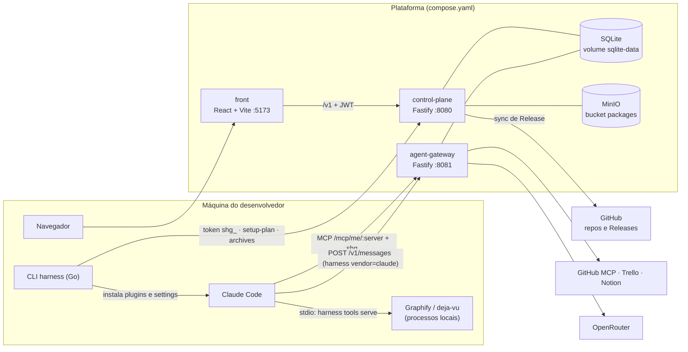

# Smart Harness

Plataforma para empacotar, publicar e instalar Tools, Skills e Agents no Claude Code, com credenciais e permissões centralizadas num gateway.

[](https://github.com/nelsonfrugeri-tech/smart-harness/actions/workflows/ci.yml)
[](https://github.com/nelsonfrugeri-tech/smart-harness/actions/workflows/docs.yml)

**[Guia do produto](https://nelsonfrugeri-tech.github.io/smart-harness/)** · [Demo guiada](https://nelsonfrugeri-tech.github.io/smart-harness/#/demo) · [Issues](https://github.com/nelsonfrugeri-tech/smart-harness/issues)

## O que é

**Problema.** Uma tarefa começa no Trello. A decisão técnica está no Notion. O código está no GitHub. As práticas da equipe estão espalhadas. Antes de codar, cada pessoa reúne esse contexto e o explica de novo ao coding agent.

**Solução.** O Smart Harness empacota capacidades no formato aberto **Agent Plugins** e as distribui por um Marketplace:

- **Tools**: acesso via MCP a GitHub, Trello, Notion, Graphify e deja-vu.
- **Skills**: instruções reutilizáveis de desenvolvimento, teste e review.
- **Agents**: papéis com instruções e acesso às Tools e Skills necessárias.

A CLI `harness` instala os pacotes autorizados no Claude Code. O **agent-gateway** guarda as credenciais dos provedores e a chave de modelo. A máquina do desenvolvedor recebe só um token pessoal `shg_`.

**Quem usa.** Quem desenvolve instala e usa os pacotes no próprio checkout. Quem mantém a equipe publica pacotes versionados pelo GitHub.

**Status.** POC na Fase 1. O único cliente suportado é o Claude Code. Veja a [ADR-0001](docs/adr/propose-arch.md).

## Sumário

- [Ambiente local (quickstart)](#ambiente-local)
- [Arquitetura](#arquitetura)
- [Mapa do repositório](#mapa-do-repositório)
- [Conceitos essenciais](#conceitos-essenciais)
- [Fluxo de desenvolvimento](#fluxo-de-desenvolvimento)
- [Receitas: onde mexer em cada tipo de feature](#receitas-onde-mexer-em-cada-tipo-de-feature)
- [Testes e quality gates](#testes-e-quality-gates)
- [Publicar um pacote](#publicar-um-pacote)
- [Convenções](#convenções)
- [Troubleshooting e FAQ](#troubleshooting-e-faq)
- [Documentação adicional](#documentação-adicional)
- [Licença](#licença)

## Ambiente local

### Pré-requisitos

| Ferramenta | Versão | Fonte |
| --- | --- | --- |
| Node.js | 24 | `engines` em `control-plane/package.json` e `agent-gateway/package.json`; CI |
| Go | 1.27 | `cli/go.mod` |
| Docker | com `docker compose` | `Makefile` (`up`, `down`, `seed`) |
| make | qualquer | `Makefile` |

Para usar a CLI no Claude Code, instale também Claude Code e curl. Graphify exige uv e Python ≥ 3.10. deja-vu exige Go ≥ 1.25.

### Subir a plataforma

Execute a partir de um diretório de trabalho:

```bash
git clone https://github.com/nelsonfrugeri-tech/smart-harness.git
cd smart-harness
cp .env.example .env
make up
make seed
```

O que cada passo faz:

| Comando | Efeito |
| --- | --- |
| `cp .env.example .env` | Cria a configuração local. Só na primeira vez. O `.env` está no `.gitignore`. |
| `make up` | Reconstrói as imagens e sobe `api`, `gateway` e `minio`. Espera os healthchecks. |
| `make seed` | Cria a identidade local e publica sete pacotes. É idempotente. Exige `APP_ENV=local`. |

O `.env.example` já traz `APP_ENV=local` e valores locais para `JWT_SECRET` e `S3_*`. Sem essas três variáveis, o Compose recusa subir.

### Abrir o frontend

Em outro terminal, na raiz do repositório:

```bash
npm --prefix front ci --no-audit --no-fund
HARNESS_API_TARGET=http://127.0.0.1:8080 HARNESS_PUBLIC_API_URL=http://127.0.0.1:8080 npm --prefix front run dev -- --port 5173 --strictPort
```

Abra http://127.0.0.1:5173. O login local usa só o e-mail:

| E-mail | Papel | Uso |
| --- | --- | --- |
| `dev@smart-harness.local` | DEV | Jornada de quem desenvolve: Perfil, token, Marketplace e CLI |
| `admin@smart-harness.local` | ADMIN | Publicar pacotes em **Marketplace → Publicar do GitHub** |

O login por e-mail (`POST /v1/auth/dev-login`) só existe com `APP_ENV=local`. Não é um fluxo de produção.

### Endereços locais

Todas as portas são publicadas só em `127.0.0.1`.

| Serviço | URL | Variável |
| --- | --- | --- |
| control-plane (API) | http://127.0.0.1:8080 | `API_PORT` |
| agent-gateway | http://127.0.0.1:8081 | `GATEWAY_PORT` |
| MinIO | http://127.0.0.1:9000 | `MINIO_PORT` |
| front (Vite) | http://127.0.0.1:5173 | flag `--port` |

API e gateway expõem `GET /healthz`, `GET /readyz` e `GET /metrics`. Para conferir a API:

```bash
curl -fsS http://127.0.0.1:8080/readyz
```

### Conectar a CLI ao Claude Code

1. Entre como `dev@smart-harness.local`. Em **Perfil**, crie um token.
2. Abra a tela **CLI** e copie o comando de instalação. No ambiente local padrão:

```sh
curl -fsSL 'http://127.0.0.1:8080/install' | sh
```

O instalador baixa o binário da própria API, verifica SHA-256 e pede o token sem eco. Depois confira:

```sh
harness doctor
harness tools check
harness skills check
```

Abra uma sessão no checkout do seu projeto. `claude` usa sua conta nativa. `harness vendor=claude` usa OpenRouter pelo gateway, só naquele processo, com o modelo padrão `openrouter/free`:

```sh
harness vendor=claude
```

O roteiro completo está em [docs/onboarding.md](docs/onboarding.md) e em [Primeiros passos](https://nelsonfrugeri-tech.github.io/smart-harness/#/quickstart).

### Conectores reais (opcional)

Sem credenciais, os servidores `github`, `trello` e `notion` ficam desligados no gateway. Para ligá-los, preencha no `.env`:

| Variável | Uso |
| --- | --- |
| `GITHUB_TOKEN` | Token fine-grained somente leitura |
| `TRELLO_API_KEY`, `TRELLO_TOKEN` | Credenciais do Trello, sempre juntas |
| `NOTION_TOKEN` | Token de integração interna do Notion |
| `DEMO_GITHUB_REPO`, `DEMO_TRELLO_BOARD_ID`, `DEMO_NOTION_PAGE_IDS` | Recursos liberados para o usuário DEV |
| `MODEL_UPSTREAM_KEY` | Chave OpenRouter do proxy de modelos. Vazia: `POST /v1/messages` responde 503 |

Depois aplique a mudança:

```bash
make up
make seed
```

Permissão vazia nega o acesso ao recurso. As credenciais nunca saem do gateway.

### Parar

```bash
make down
```

`make down` para os serviços e preserva os volumes `sqlite-data` e `minio-data`.

## Arquitetura



Como ler o diagrama:

- O **front** e a **CLI** falam com a API. O front usa JWT; a CLI usa o token `shg_`.
- O **Claude Code** chama MCPs remotos e modelos sempre pelo gateway. As credenciais dos provedores ficam no gateway.
- API e gateway compartilham o mesmo arquivo SQLite (`DATABASE_PATH`). A API cria e migra o banco. O gateway lê tokens e permissões e grava auditoria.
- A API executa o binário `harness` para validar, gerar e empacotar pacotes. Pacotes publicados por GitHub Release ficam no GitHub; pacotes do seed ficam no MinIO.

### Componentes

| Componente | Pasta | Stack | Porta | Responsabilidade | README |
| --- | --- | --- | --- | --- | --- |
| CLI `harness` | `cli/` | Go 1.27, `go.yaml.in/yaml/v3` | — | Engine de pacotes (validate, generate, pack) e instalação no Claude Code | [cli/README.md](cli/README.md) |
| control-plane | `control-plane/` | Node 24, TypeScript, Fastify, better-sqlite3, S3 SDK | 8080 | Identidade, Marketplace, versões, setup-plan, tokens, instalador, publicação | [control-plane/README.md](control-plane/README.md) |
| agent-gateway | `agent-gateway/` | Node 24, TypeScript, Fastify, MCP SDK | 8081 | Proxy MCP com permissão por recurso, auditoria e proxy de modelos | [agent-gateway/README.md](agent-gateway/README.md) |
| front | `front/` | React 19, Vite, TypeScript | 5173 | Perfil, tokens, Marketplace, publicação e guia da CLI | [front/README.md](front/README.md) |
| marketplace | `marketplace/` | Fontes Agent Plugins + builders `.mjs` | — | Fontes e builders reproduzíveis dos pacotes do seed | [marketplace/README.md](marketplace/README.md) |
| docs site | `docs/site/` | HTML/JS estático | — | Guia do produto no GitHub Pages | [docs/site-documentation.md](docs/site-documentation.md) |

A visão completa, com responsabilidades e credenciais, está em [Arquitetura](https://nelsonfrugeri-tech.github.io/smart-harness/#/architecture) e na [ADR-0001](docs/adr/propose-arch.md).

## Mapa do repositório

```text
.
├── cli/                      CLI harness e engine de pacotes (único go.mod)
│   ├── cmd/harness/          comandos da CLI (main.go, *_test.go ao lado)
│   └── internal/
│       ├── engine/           pkg, validate, converter, digest, pack
│       ├── client/           api, install, local, localtools, reconcile
│       └── scaffold/         templates do harness new (inclui release.yml.tmpl)
├── control-plane/            API
│   ├── src/                  main.ts, config.ts, domain/, db/repos/, http/routes/, github/, harness/, storage/
│   ├── migrations/           SQL numerado NNNN_name.sql
│   ├── seed/                 seed local e pacotes .tar.gz do seed
│   ├── test/                 testes, espelhando src/
│   └── openapi.json          contrato HTTP (OpenAPI 3.1)
├── agent-gateway/            gateway MCP e de modelos
│   ├── src/                  backends/, mcp/, model-proxy/, db/, http/
│   └── test/                 testes, espelhando src/
├── front/                    SPA React
│   ├── src/                  pages/, components/, app/, api/, styles/
│   ├── test/                 testes, espelhando src/
│   └── scripts/              contract-types.mjs (tipos a partir do openapi.json)
├── marketplace/              fontes dos pacotes, builders build-*.mjs e test/
├── examples/                 contexto dos projetos de exemplo (investimentos-api, md2poui)
├── docs/                     ADR, contratos, spikes, onboarding e site/
├── spikes/                   código dos spikes H1–H3
├── .github/                  workflows ci, docs e release; templates de issue e PR
├── compose.yaml              api, gateway e minio
├── Makefile                  up, down, seed, check*, package-*
└── .env.example              configuração local
```

## Conceitos essenciais

| Termo | Significado |
| --- | --- |
| **Agent Plugins** | Formato aberto do núcleo do pacote: `plugin.json`, `mcp.json` opcional e `skills/`. |
| **Pacote** | Diretório Agent Plugins versionado em SemVer. Vira um `.tar.gz` reproduzível com digest `sha256:`. Versões publicadas são imutáveis. |
| **Skill** | `skills/<nome>/SKILL.md`, com referências e assets opcionais. |
| **Agent** | Extensão do projeto em `dev.smartharness/agents/<nome>.agent.md`. Contrato em [docs/contracts/agent.md](docs/contracts/agent.md). |
| **Tool / connector** | Pacote cujo componente é um MCP. No produto o nome é Tools; na sintaxe do agent, `connector:<nome>`. |
| **Local connector** | MCP local curado (`graphify` ou `deja-vu`), executado por `harness tools serve`. Não aceita comandos arbitrários. |
| **Tipo do pacote** | Calculado pela API: só MCPs → `connector`; só skills → `skill`; o resto → `agent`. |
| **Marketplace** | Catálogo da API. Cada pacote pertence a uma squad (tenant) e tem visibilidade `squad` ou `organization`. |
| **Target / harness** | Coding agent de destino. `harness generate --target claude-code` gera `.claude-plugin/plugin.json`, `.mcp.json` e `agents/`. |
| **`vendor=claude`** | Launcher `harness vendor=claude`: abre o Claude Code com modelo via gateway, só naquele processo. |
| **Token do gateway** | `shg_` + 43 caracteres. Autentica a CLI na API e o Claude Code no gateway. O banco guarda só o hash. Validade padrão de 90 dias. |
| **setup-plan** | Resposta da API que diz à CLI o que instalar (`GET /v1/me/setup-plan`). |
| **Seed** | Dados locais de `make seed`: usuários, squad e sete pacotes (Tools `github`, `trello`, `notion`, `graphify`, `deja-vu`; Skills `md2poui`, `code-review`). |
| **Release** | GitHub Release com `<nome>-<versão>.tar.gz` e `SHA256SUMS`, importada pelo Marketplace. |

## Fluxo de desenvolvimento

1. **Defina a feature numa Issue.** Use o template [Feature](.github/ISSUE_TEMPLATE/feature.yml): problema, resultado, escopo, critérios de aceite e validação.
2. **Crie uma branch a partir de `master`.** O histórico usa `feat/<issue>-<slug>`, `fix/<slug>` e `docs/<slug>`. Um worktree separado evita misturar trabalho. Exemplo para a Issue 42:

```bash
git fetch origin
git worktree add ../smart-harness-42 -b feat/42-my-feature origin/master
```

3. **Implemente no componente certo.** Veja as [receitas](#receitas-onde-mexer-em-cada-tipo-de-feature).
4. **Rode o gate do componente e depois `make check`.** Veja [Testes e quality gates](#testes-e-quality-gates).
5. **Atualize a documentação afetada.** README do componente, `docs/` e, se o comportamento visível mudou, `docs/site/content.js`.
6. **Abra o PR** com o [template](.github/pull_request_template.md): problema e resultado, Issue (`Closes #<número>`), validação com evidências e limitações. O CI roda `make check`.

## Receitas: onde mexer em cada tipo de feature

### Novo comando da CLI

| Passo | Arquivo |
| --- | --- |
| Registrar o comando no `switch` e na constante `usage` | `cli/cmd/harness/main.go` |
| Implementar o comando | `cli/cmd/harness/<comando>.go` (use `parseArgs` de `main.go`) |
| Testar | `cli/cmd/harness/<comando>_test.go` |
| Lógica reutilizável | `cli/internal/client/...` ou `cli/internal/engine/...` |
| Documentar | tabela de comandos em `cli/README.md` e página `cli` em `docs/site/content.js` |

Exit codes: `0` sucesso, `1` pacote inválido ou operação recusada, `2` uso incorreto ou erro de I/O. Gate: `make check-go`.

### Nova rota da API (com migration)

| Passo | Arquivo |
| --- | --- |
| Criar a migration seguinte | `control-plane/migrations/0012_<nome>.sql` (a última é `0011`) |
| SQL de leitura e escrita | `control-plane/src/db/repos/<recurso>.ts` (todo SQL fica em `repos/`) |
| Regra de negócio | `control-plane/src/domain/<recurso>.ts` |
| Rota | `control-plane/src/http/routes/<recurso>.ts`, registrada em `control-plane/src/http/server.ts` |
| Contrato | `control-plane/openapi.json` (o teste `test/http/openapi.test.ts` compara spec e rotas) |
| Testes | `control-plane/test/http/routes/<recurso>.test.ts` e `control-plane/test/db/...` |
| Tipos do front | `npm --prefix front run contract:types` (gera `front/src/api/schema.d.ts`) |

Regras que valem sempre:

- Migration aplicada não muda. A API recusa subir se um arquivo aplicado mudar ou sumir. Mudança de schema é sempre uma migration nova.
- Toda leitura de dados de tenant recebe o `Scope` do usuário. Recurso de outro tenant responde o mesmo 404 de recurso inexistente.
- Rota nova nasce fechada para o token `shg_`. Para aceitá-lo, registre a rota com `config: GATEWAY_TOKEN_ALLOWED` (`control-plane/src/http/auth.ts`).
- Erros usam `application/problem+json`. Listas usam `?limit=` e `?cursor=` com `{items, next_cursor}`.

Gate: `npm --prefix control-plane run check` e, se o contrato mudou, `npm --prefix front run check`.

### Novo backend MCP no gateway

| Passo | Arquivo |
| --- | --- |
| Implementar `McpBackend` | `agent-gateway/src/backends/<servidor>.ts` (interface em `agent-gateway/src/mcp/backend.ts`) |
| Registrar quando houver credencial | `configuredBackends` em `agent-gateway/src/backends/index.ts` |
| Ler configuração | `agent-gateway/src/config.ts` |
| Expor no Compose | `compose.yaml` (serviço `gateway`) e `.env.example` |
| Testar | `agent-gateway/test/backends/<servidor>.test.ts` (fakes em `test/backends/fakes.ts`) |
| Empacotar como Tool | `marketplace/connectors/` e `marketplace/build-connectors.mjs` |

Toda tool declara `access` (`resource`, `search` ou `project`). Tool sem `access` não aparece em `tools/list` e é negada. Chamadas negadas não chegam ao backend e são auditadas. Gate: `npm --prefix agent-gateway run check`.

### Nova página no front

| Passo | Arquivo |
| --- | --- |
| Página | `front/src/pages/<Pagina>.tsx` |
| Rota | `front/src/app/navigation.ts` (lê o path) e `front/src/app/App.tsx` (renderiza pelo `route.kind`) |
| Link na navegação | `front/src/components/Shell.tsx` |
| Chamada à API | `front/src/api/client.ts`, com tipos de `front/src/api/schema.d.ts` (gerado; não edite à mão) |
| Estilo | `front/src/styles/` |
| Testes | `front/test/pages/<Pagina>.test.tsx` |

Gate: `npm --prefix front run check` (contrato, formato, lint, testes e build). Para formatar: `npm --prefix front run format`.

### Novo pacote para o Marketplace

O caminho padrão é um repositório próprio, publicado por GitHub Release. Veja [Publicar um pacote](#publicar-um-pacote).

Para incluir um pacote no **seed local**:

| Passo | Arquivo |
| --- | --- |
| Fonte do pacote | `marketplace/<nome>/` |
| Builder que valida, gera e empacota | `marketplace/build-*.mjs` (grava em `control-plane/seed/packages/`) |
| Manifesto do seed pessoal | `control-plane/seed/personal-packages.ts` |
| Teste de reprodutibilidade | `marketplace/test/*.test.mjs` |

Archives são imutáveis. Mudar os bytes exige uma versão nova. Gate: `make check-marketplace`.

### Novo coding agent de destino (target)

Crie `cli/internal/engine/converter/<harness>/` com um `Adapter` e adicione-o em `cli/internal/engine/converter/targets/targets.go`. A suíte `cli/internal/engine/converter/conformance_test.go` roda em todo adapter. Pacote, API e gateway não mudam. Detalhes em [cli/README.md](cli/README.md#converter).

## Testes e quality gates

O gate completo é `make check`. O CI ([ci.yml](.github/workflows/ci.yml)) roda o mesmo alvo em todo push na `master` e em todo pull request.

```bash
make check
```

| Alvo | O que roda |
| --- | --- |
| `make check-go` | `gofmt -l cli`, `go vet`, `go test` e build de `cli/bin/harness` |
| `make check-node` | `npm run check` em `control-plane`, `agent-gateway` e `front`. Roda `npm ci` quando falta `node_modules` ou o `package-lock.json` muda |
| `make check-examples` | Testes unitários de `examples/investimentos-api` |
| `make check-marketplace` | Compila a CLI e roda `node --test marketplace/test/*.test.mjs` |

Gate por componente:

| Componente | Comando | Etapas |
| --- | --- | --- |
| cli | `make check-go` | gofmt, vet, test, build |
| control-plane | `npm --prefix control-plane run check` | `tsc`, ESLint, Vitest |
| agent-gateway | `npm --prefix agent-gateway run check` | `tsc`, ESLint, Vitest |
| front | `npm --prefix front run check` | contrato, Prettier, ESLint, Vitest, build |
| docs site | `node docs/check-site.mjs` | páginas, links internos, anchors, assets e sintaxe JS |

Os testes do agent-gateway usam as migrations e o seed do control-plane. Rode `npm ci` nos dois antes; `make check` faz isso.

Os testes não comprovam o acesso real a GitHub, Trello, Notion ou OpenRouter. Para isso, faça uma leitura real por cada Tool com a plataforma em pé.

Outros workflows:

| Workflow | Gatilho | Efeito |
| --- | --- | --- |
| [release.yml](.github/workflows/release.yml) | tag `v*` neste repositório | `make check-go`, binários da CLI para macOS e Linux (arm64, amd64), `SHA256SUMS` e GitHub Release |
| [docs.yml](.github/workflows/docs.yml) | push na `master` em `docs/site/**` | `node docs/check-site.mjs` e deploy no GitHub Pages |

## Publicar um pacote

Fluxo: código → PR → merge → tag → GitHub Release → sync no Marketplace → instalação.

**1. Crie o repositório de autoria.** O comando gera `package/`, `README.md` e `.github/workflows/release.yml`:

```sh
harness new agent my-agent
cd my-agent
```

Use `tool`, `skill` ou `agent`. `--directory <path>` troca o destino.

**2. Valide, gere e empacote localmente:**

```sh
harness validate package
harness generate package --target claude-code
harness validate package
harness pack package -o ../my-agent-1.0.0.tar.gz
```

**3. Publique a versão.** Depois do merge, crie a tag igual à `version` de `package/plugin.json`:

```sh
git tag v1.0.0
git push origin v1.0.0
```

O workflow gerado valida, gera a camada Claude Code e publica `<nome>-<versão>.tar.gz` com `SHA256SUMS`. Este repositório é público, então o workflow baixa a CLI sem secret. O secret `HARNESS_RELEASE_TOKEN` só é necessário se ele se tornar privado.

**4. Importe no Marketplace.** Como ADMIN, abra **Marketplace → Publicar do GitHub**, escolha squad e visibilidade e informe a tag. A API baixa o asset, valida, confere versão e digest e registra a origem.

**5. Instale:**

```sh
harness agents install my-agent
harness agents check
```

Para outras categorias, use `harness tools install <nome>` ou `harness skills install <nome>`. Detalhes em [Publicar no GitHub](https://nelsonfrugeri-tech.github.io/smart-harness/#/publish) e em [control-plane/README.md](control-plane/README.md#publicação-de-pacotes-pelo-github).

## Convenções

| Tema | Regra |
| --- | --- |
| Idioma | Código, comentários, logs, mensagens de erro, help, testes, fixtures e commits em inglês. Documentação, ADRs, issues e PRs em pt-BR, com termos técnicos em inglês. |
| Simplicidade | Pastas por responsabilidade, nomes explícitos e poucas dependências, justificadas no README do componente. |
| Resiliência | Sem retry, backoff ou circuit breaker na Fase 1. |
| Testes TypeScript | `src/` só tem código de produção. Testes e helpers ficam em `test/`, espelhando `src/`. |
| Testes Go | `_test.go` ao lado do código. |
| Banco | Mudança de schema é sempre uma migration SQL nova. |
| Código gerado | Não edite `front/src/api/schema.d.ts` nem a camada Claude Code de um pacote. Mude a fonte e gere de novo. |
| Segredos | Nada de credencial em pacote, log ou commit. `validate` recusa arquivos com forma de credencial. |

As regras de projeto estão em [CLAUDE.md](CLAUDE.md).

## Troubleshooting e FAQ

**O Compose recusa subir com `set JWT_SECRET in .env`.**
Falta o `.env`. Execute `cp .env.example .env` e rode `make up` de novo.

**`make seed` falha com `seed refused: APP_ENV must be local`.**
Configure `APP_ENV=local` no `.env` e rode `make up` antes do seed.

**Quero começar com um banco limpo sem perder o atual.**
Não remova volumes. Troque o arquivo do banco no `.env`:

```dotenv
DATABASE_PATH=/data/personal-demo.sqlite
```

Depois rode `make up` e `make seed`. API e gateway leem a mesma variável. O banco anterior continua no volume. Para voltar, use `DATABASE_PATH=/data/control-plane.sqlite` e rode `make up`. Tokens não são copiados entre bancos.

**O seed acusa conflito de propriedade de um pacote.**
Um pacote com o mesmo nome já pertence a outra squad nesse banco. Use outro `DATABASE_PATH`, como acima.

**A API não sobe e o log cita uma migration alterada.**
Uma migration aplicada mudou ou sumiu. Restaure o arquivo original e crie uma migration nova com a mudança.

**Porta 8080, 8081 ou 9000 ocupada.**
Troque `API_PORT`, `GATEWAY_PORT` ou `MINIO_PORT` no `.env` e rode `make up`. O Compose deriva `PUBLIC_API_URL` de `API_PORT` e a URL do gateway de `GATEWAY_PORT`. No front, use a nova URL da API em `HARNESS_API_TARGET` e `HARNESS_PUBLIC_API_URL`.

**`/install` responde 503.**
Os assets do instalador não estão disponíveis. Pelo Docker, a imagem já os inclui. Fora do Docker, defina `INSTALLER_ASSETS_DIR`.

**Qual versão a CLI instalada mostra?**
`INSTALLER_VERSION` define o nome e a versão dos binários servidos em `/install`. O `.env.example` traz `v0.2.1`; sem a variável, o Compose usa `v0.2.3`.

**`harness: command not found` depois de instalar.**
Siga a orientação de PATH do instalador ou abra um novo terminal.

**Uma Tool remota não lê o recurso.**
Confira a credencial do provedor no gateway e a permissão `DEMO_*` correspondente. Depois rode `make up` e `make seed`. `harness doctor` aponta falhas de token, gateway e settings.

**Graphify não encontra o grafo.**
No checkout do projeto, gere o grafo e reconecte o MCP:

```sh
harness tools run graphify update ./src
```

Mais sintomas em [Diagnóstico](https://nelsonfrugeri-tech.github.io/smart-harness/#/troubleshooting).

## Documentação adicional

| Documento | Conteúdo |
| --- | --- |
| [Guia do produto](https://nelsonfrugeri-tech.github.io/smart-harness/) | Conceitos, arquitetura, primeiros passos, CLI, publicação e demo guiada. Fonte em [docs/site/](docs/site/) |
| [docs/site-documentation.md](docs/site-documentation.md) | Como editar, validar e publicar o site |
| [docs/onboarding.md](docs/onboarding.md) | Jornada pessoal: token, instalação, desenvolvimento e review |
| [docs/adr/propose-arch.md](docs/adr/propose-arch.md) | ADR-0001: arquitetura do backend |
| [docs/contracts/agent.md](docs/contracts/agent.md) | Contrato do arquivo de agente e da conversão para Claude Code |
| [docs/api/contrato-front.md](docs/api/contrato-front.md) | Índice das rotas consumidas pelo front |
| [docs/spikes/](docs/spikes/) | Spikes H1, H2 e H3 |
| [control-plane/openapi.json](control-plane/openapi.json) | Contrato HTTP da API |
| [marketplace/README.md](marketplace/README.md) | Pacotes do seed e seus builders |
| [examples/README.md](examples/README.md) | Projetos de exemplo. [examples/md2poui](examples/md2poui/README.md) guarda o contexto da tarefa de exemplo no md2poui (upstream open source `totvs/md2poui`) |

## Licença

Este repositório ainda não tem arquivo `LICENSE`. Não há licença declarada.
